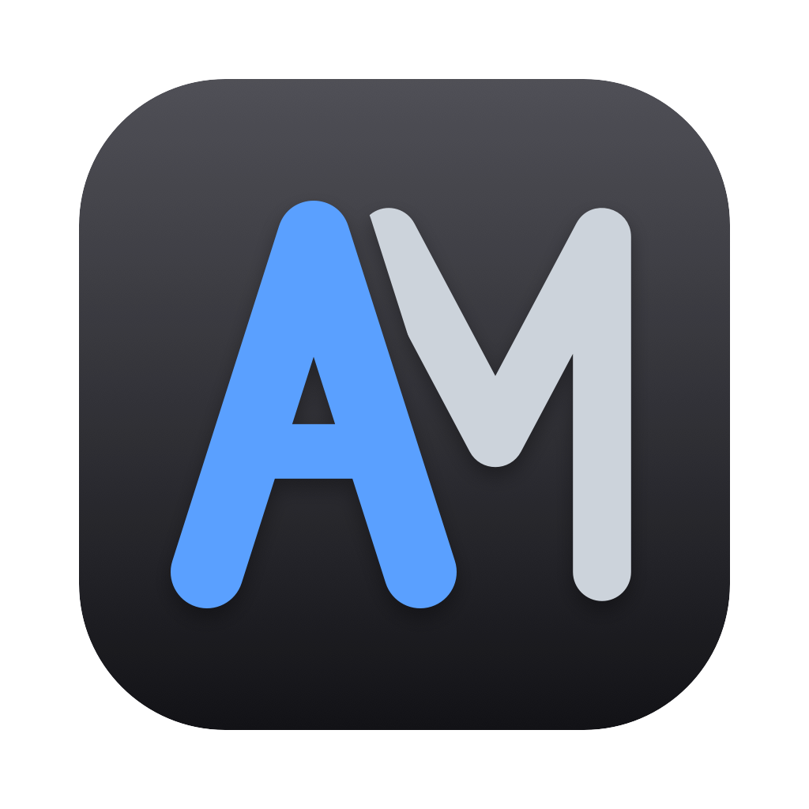

<p align="center">
  
</p>

# AgentMaster

[](https://github.com/hustshawn/agent-master/actions/workflows/release.yml)
[](https://github.com/hustshawn/agent-master/releases/latest)


One native macOS app for all your coding-agent CLIs.

AgentMaster runs each agent's real TUI in an embedded terminal and manages them from one window. You get a session sidebar across projects and agents, live panels for the current session, and per-agent defaults. It does not reimplement any agent. Every CLI keeps its own harness and works exactly as it does in your terminal, with its own config, instructions, skills, MCP servers, hooks and plugins. AgentMaster only adds a thin, per-session layer on top.

## Supported agents

| Agent | Status and panels | Restore on launch | Header usage and cost |
|---|---|---|---|
| [Claude Code](https://docs.claude.com/en/docs/claude-code/overview) | ✓ via hooks passed with `--settings` | ✓ `claude --resume` | ✓ via the status line |
| [OpenAI Codex CLI](https://github.com/openai/codex) | ✓ via hooks passed with `-c`, which needs `--dangerously-bypass-hook-trust` ([why](docs/adr/0009-codex-agent.md)) | ✓ `codex resume` | — |

More agents can be added without touching the UI. See [Adding an agent](#adding-an-agent).

## Features

- **Every agent in one sidebar.** Sessions are grouped by project, whichever agent runs them. Each session is titled by its first prompt, and you can rename it. Sessions from agents other than Claude Code are labelled with the agent's name, for example `Codex · idle`.
- **New session panel.** Every ＋ opens a panel where you choose the agent and, if you want, a model other than its default. ⌘N starts Claude Code in the current project, and ⌥⌘N starts Codex.
- **Restore on launch.** Sessions that were open when you quit come back and resume their conversations.
- **Review inspector.** A collapsible side panel (⌥⌘0) shows todos, subagents and file changes for the selected session.
- **Header status.** The model and permission mode, plus context usage and cost where the agent reports them.
- **Per-agent settings (⌘,).** Each agent has its own page. It shows where the binary was found and holds its defaults for new sessions, such as model, permission mode, sandbox and approval policy.
- **Non-invasive.** Hooks are injected into each session through the agent's own command-line options. AgentMaster never edits your global Claude Code or Codex configuration. If AgentMaster isn't running, every agent behaves as usual.

## Requirements

- macOS 14 or later
- Xcode 15.4 (Swift 5.10) or later
- At least one supported agent. Each is looked up in this order:

  | Agent | Override variable | Then |
  |---|---|---|
  | Claude Code | `AGENTMASTER_CLAUDE_PATH` | `~/.local/bin/claude`, Homebrew, `/usr/local/bin`, your login shell's `PATH` |
  | Codex CLI 0.154 or later | `AGENTMASTER_CODEX_PATH` | `~/.local/bin/codex`, Homebrew, `/usr/local/bin`, your login shell's `PATH` |

## Download

Each tagged version is published on the [Releases](https://github.com/hustshawn/agent-master/releases) page as `AgentMaster-<tag>.zip`, built for Apple silicon. The app is ad-hoc signed and not notarized, so after moving it to Applications run `xattr -dr com.apple.quarantine /Applications/AgentMaster.app` before the first launch.

## Build and run

```bash
./scripts/bundle.sh          # builds build/AgentMaster.app (ad-hoc signed)
open build/AgentMaster.app
```

### Releasing

Pushing a tag that starts with `v` runs `.github/workflows/release.yml`. It tests, bundles with the tag as the version, and creates the GitHub release with the zip attached:

```bash
git tag v0.2.0 && git push origin v0.2.0
```

## Development

```bash
swift build
swift test                   # unit and integration tests
python3 scripts/smoke.py     # end-to-end check against the real claude (uses a few cents of Haiku tokens)
swift scripts/make-icon.swift  # regenerate Assets/AppIcon.icns
```

The code is a single SwiftPM package with these targets:

| Target | Role |
|---|---|
| `AgentMasterCore` | Domain models, session state reducer, theme tokens |
| `AgentMasterWire` | NDJSON protocol over a Unix socket, hook shim logic |
| `agentmaster-hook` | Small helper that every agent calls as its hook |
| `AgentMasterBridge` | Agent adapters and registry, hook dialects and translation, launch environment, session restore |
| `TerminalKit` | SwiftTerm wrapper |
| `AgentMasterUI` | Sidebar, inspector, header, new-session panel and settings views |
| `AgentMaster` | The app |

### Adding an agent

Each agent is one file in `Sources/AgentMasterBridge/`. It declares only how its CLI differs:

- where its binary lives
- its settings
- how it loads AgentMaster's hooks
- its other launch arguments
- how its hook payloads read, if they differ from Claude Code's

Finding the binary, the session environment, resuming, the panels, the new-session panel, Settings and the menus are shared. Add the new agent to `AgentRegistry.all` and it shows up everywhere. The checklist, with a comparison of Claude Code, Codex and Kiro CLI, is in [ADR 0010](docs/adr/0010-agent-adapter.md).

## Documentation

- Design: [`docs/superpowers/specs/`](docs/superpowers/specs/)
- Decisions: [`docs/adr/`](docs/adr/)

## Status

This is an early internal tool and is still under active development. The roadmap, in order:

1. A git-based review of changes
2. Subagent results in the inspector
3. Native approval and question prompts
