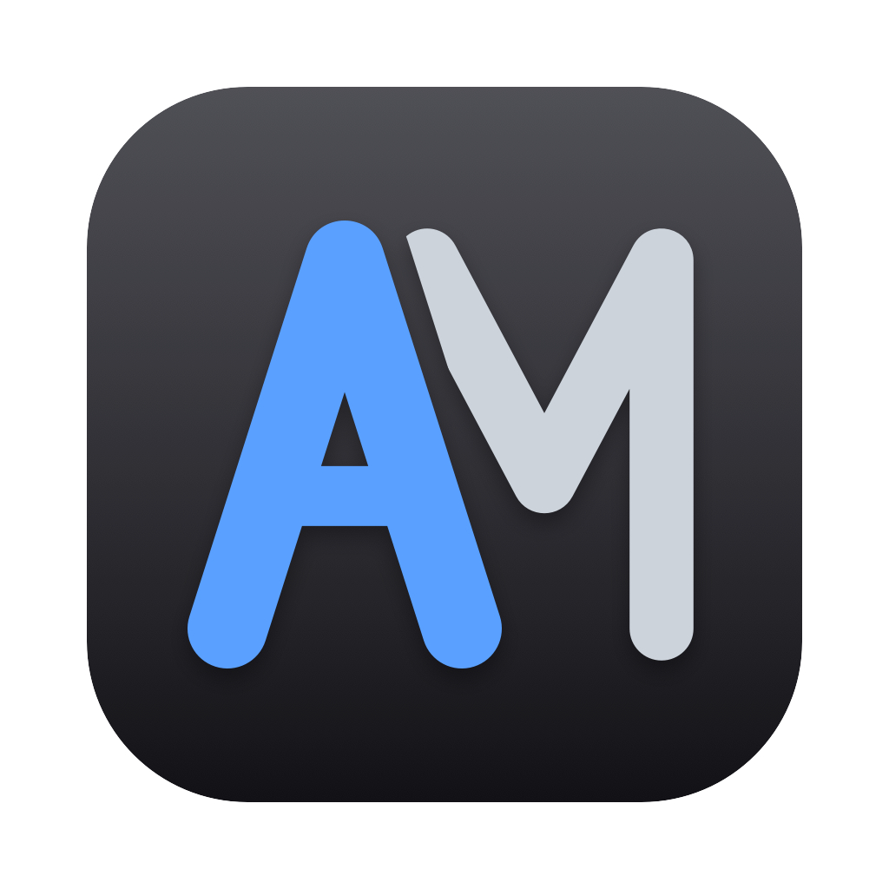
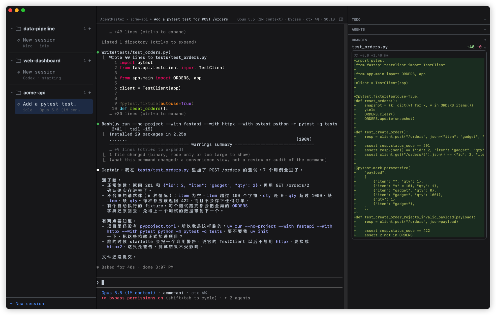
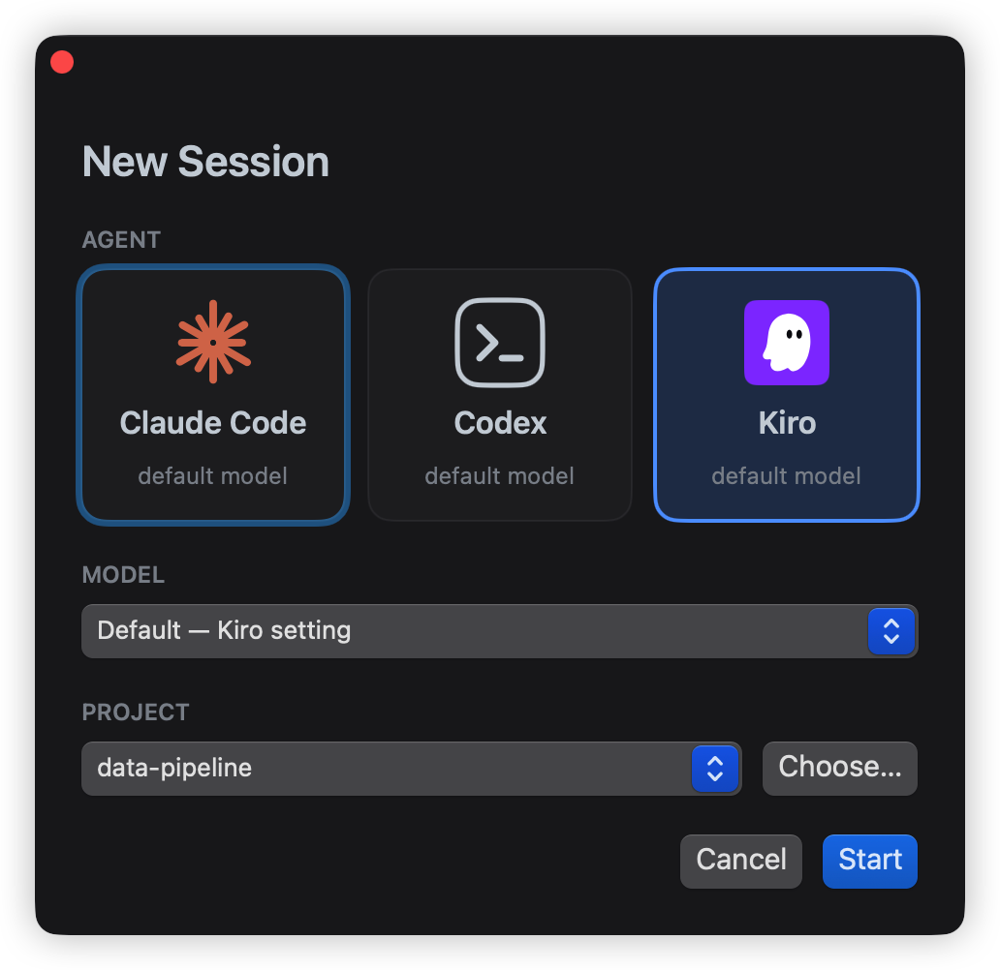

<p align="center">
  
</p>

> **AI agent asked to install AgentMaster on a (Linux) server?** Follow [docs/INSTALL-AGENT.md](docs/INSTALL-AGENT.md) and ignore the macOS app parts of this README.

# AgentMaster

[](https://github.com/hustshawn/agent-master/actions/workflows/ci.yml)
[](https://github.com/hustshawn/agent-master/releases/latest)


[](LICENSE)

One place to run and manage all your coding-agent CLIs, as a native macOS app or in the browser.

<p align="center">
  
</p>

AgentMaster runs each agent's real TUI in an embedded terminal and manages them from one window. You get a session sidebar across projects and agents, live panels for the current session, and per-agent defaults. It does not reimplement any agent. Every CLI keeps its own harness and works exactly as it does in your terminal, with its own config, instructions, skills, MCP servers, hooks and plugins. AgentMaster only adds a thin, per-session layer on top.

## Two editions

| | Mac app | Web edition |
|---|---|---|
| What it is | `AgentMaster.app`, a native macOS app | `agentmaster-server`, a server that serves the same UI to a browser |
| Where the agents run | On your Mac | On the machine the server runs on, usually a remote Linux server |
| Use it to | Work with agents on your own machine | Run agents on a remote machine, close the browser, and pick the sessions up again from anywhere |
| Get it | [Download](#mac-app) the disk image | [Install on a Linux server](#web-edition-on-a-linux-server) with one command |

Both have the sidebar, the agent's real TUI, the inspector, the new-session panel and Settings, and both support every agent below. The features below describe the Mac app. The web edition's differences are in [Web edition](#web-edition).

## Supported agents

| Agent | Status and panels | Restore on launch | Header usage and cost |
|---|---|---|---|
| [Claude Code](https://docs.claude.com/en/docs/claude-code/overview) | ✓ | ✓ `claude --resume` | ✓ via the status line |
| [OpenAI Codex CLI](https://github.com/openai/codex) | ✓, started with `--dangerously-bypass-hook-trust` ([why](docs/adr/0009-codex-agent.md)) | ✓ `codex resume` | — |
| [Kiro CLI](https://kiro.dev/docs/cli/) | ✓ on the V2 engine ([trade-offs](docs/adr/0012-kiro-agent.md)) and on V3 ([why](docs/adr/0014-kiro-v3-engine.md)) | ✓ `kiro-cli chat --resume-id` | — |

More agents can be added without touching the UI. See [Adding an agent](CONTRIBUTING.md#adding-an-agent).

## Features

- **Every agent in one sidebar.** Sessions are grouped by project, whichever agent runs them. Each session is titled by its first prompt, and you can rename it. Sessions from agents other than Claude Code are labelled with the agent's name, for example `Codex · idle`.
- **New session panel.** Every ＋ opens a panel where you choose the agent, the project and, if you want, a model other than its default. ⌘N starts another session with the selected session's agent in its project, ⌥⌘N starts Codex, and ⌃⌘N starts Kiro.

  

- **Open a folder from Finder.** Right-click a folder in Finder and choose Services → Open in AgentMaster, or drop it on AgentMaster's Dock icon. The new-session panel opens with that folder as the project. Files and folders dropped on a session's terminal are typed in as their paths, as Terminal does.

- **Restore on launch.** Sessions that were open when you quit come back and resume their conversations.
- **Review inspector.** A collapsible side panel (⌥⌘0) shows todos, subagents and file changes for the selected session.
- **Summarize a session.** Click Summarize at the top of the inspector, or right-click a session and choose Summarize Session (⌥⌘S). AgentMaster reads the session's transcript and runs `claude -p` in the background, with no tools and no saved session. The inspector then shows what was done, the changed files, open items and a short retrospective. The session itself is not interrupted. The summary is kept until you quit. This needs Claude Code installed, whichever agent ran the session.
- **Header status.** The model and permission mode, plus context usage and cost where the agent reports them.
- **Per-agent settings (⌘,).** Each agent has its own page. It shows where the binary was found and holds its defaults for new sessions, such as model, permission mode, sandbox and approval policy.
- **Non-invasive.** Hooks are injected into each session through the agent's own command-line options, or for Kiro's V2 engine an agent config in the session's own folder. AgentMaster never edits your global Claude Code or Codex configuration. Kiro's V3 engine reads hooks only from Kiro's own folder, so for it AgentMaster adds one file, `~/.kiro/hooks/agentmaster.json`, which does nothing in sessions AgentMaster didn't start. If AgentMaster isn't running, every agent behaves as usual.

## Requirements

- The Mac app: macOS 14 or later, on Apple silicon
- The web edition's server: Linux x86_64 or aarch64
- At least one supported agent: Claude Code, Codex CLI 0.154 or later, or Kiro CLI 2.25 or later (the V3 engine was tested with 2.37). AgentMaster finds them in the usual install locations and on your login shell's `PATH`; if one isn't found, Settings says which variable to set to its path.

## Install

Install from the [latest release](https://github.com/hustshawn/agent-master/releases/latest). Each release has the Mac app's disk image, the [web edition](#web-edition)'s server for Linux x86_64 and aarch64, and `install-server.sh`. Building from source is for working on AgentMaster itself, or for a machine no release covers, such as an Intel Mac or the server on macOS. See [CONTRIBUTING.md](CONTRIBUTING.md#build-and-run).

### Mac app

Download `AgentMaster-<tag>.dmg` from the release, open it and drag AgentMaster to Applications. The app is ad-hoc signed and not notarized, so run `xattr -dr com.apple.quarantine /Applications/AgentMaster.app` before the first launch.

### Web edition on a Linux server

On the server (x86_64 or aarch64), log in as the user who runs `claude`, `codex` or `kiro-cli` and run:

```bash
gh release download -R hustshawn/agent-master -p install-server.sh -O - | bash
```

This downloads the latest release's server package for the machine's architecture. The Swift runtime is linked in, so the server needs no Swift. It installs to `~/.local/share/agentmaster-server` and runs as a systemd user service with lingering on, so it keeps running after you log out and restarts if it crashes. Then it prints the link with the token. No root is needed.

- Run the same command again to upgrade. Sessions, settings and the token in `~/.agentmaster-server` are kept.
- Pass options after `bash -s --`, for example `… | bash -s -- --port 9000`:
  - `--host`, `--port`: where the server listens
  - `--version v0.3.0`: install a specific release
  - `--from FILE`: install from a package you already downloaded
  - `--uninstall`: remove it
- Without `gh`, set `GITHUB_TOKEN` to a token that can read the repo. Fetch the script with `curl -fsSL -H "Authorization: Bearer $GITHUB_TOKEN" -H "Accept: application/vnd.github.raw" https://api.github.com/repos/hustshawn/agent-master/contents/scripts/install-server.sh | bash`.
- Manage it with `systemctl --user status|restart|stop agentmaster-server`, and read the logs with `journalctl --user -u agentmaster-server -f`. Where there is no systemd user session, such as a container, it falls back to `nohup`.

It listens on `127.0.0.1` by default. From your machine, `ssh -L 8765:127.0.0.1:8765 you@server` and open the printed link. For access over a network, put it behind your own TLS-terminating proxy or load balancer, and pass `--host 0.0.0.0` if the proxy is on another machine. Anyone with the token can run commands as the server's user.

## Web edition

The web edition is for running agents on a remote server. `agentmaster-server` runs the same agents on that machine (Linux or macOS) and serves the AgentMaster UI to a browser. It has the sidebar, the real agent TUI in the page (xterm.js), the inspector, the new-session panel and Settings. Sessions live on the server, so closing the browser does not stop an agent. Reconnecting shows the terminal again.

Codex and Kiro take over the mouse in their TUI, so a plain drag does not select text in their sessions. Hold Option while dragging on a Mac, or Shift elsewhere. In the Mac app, hold Shift.

Settings → General → Appearance switches the page, terminal included, between Dark, Light and System (your device's mode), for that browser only. Some colours in a TUI are the agent's own: with Light, also pick a light theme in Claude Code (`/theme`).

### Server options

`install-server.sh` sets `--host` and `--port` (see [Web edition on a Linux server](#web-edition-on-a-linux-server)) and leaves the rest at their defaults. To run `agentmaster-server` by hand from an unpacked release package, give any of them on its command line; it prints the link with the token.

| Option | Default | |
|---|---|---|
| `--host` | `127.0.0.1` | Address to listen on |
| `--port` | `8765` | |
| `--data-dir` | `~/.agentmaster-server` | Sessions, `settings.json` and the token. Separate from the Mac app's data, so both can run on one machine |
| `--token` | `AGENTMASTER_SERVER_TOKEN`, else `<data-dir>/token` | The access token. A random one is created on first start |

`agentmaster-hook` must stay next to `agentmaster-server`, and the server must run as a user whose login shell finds the agents. In the browser, Alt+N starts another session with the selected session's agent, and Alt+0 toggles the inspector. Images pasted (⌘V) or dropped into the terminal are uploaded to the session's folder in the data directory, and their path goes to the agent, which attaches them. They are deleted with the session. The design is in [ADR 0011](docs/adr/0011-web-edition.md).

## Contributing

Building, testing, releasing and adding an agent are in [CONTRIBUTING.md](CONTRIBUTING.md).

## Status

This is an early internal tool and is still under active development. The roadmap, in order:

1. A git-based review of changes
2. Subagent results in the inspector
3. Native approval and question prompts

## License

Copyright (c) 2026 Shawn Zhang. All rights reserved. The code is proprietary: using, copying or distributing it needs the copyright holder's written permission. Third-party components keep their own licenses. See [LICENSE](LICENSE).
